# 🍃 VayuDrishti: Atmospheric Air Quality Forecasting & Automated Alert System

[](https://www.python.org/)
[](https://pytorch.org/)
[](https://khushiyadav35-aqi-forecast.streamlit.app/)
[](https://cpcb.nic.in/)
[](https://github.com/khushiyadav35/air-quality-forecasting-alert-system/actions)
[](LICENSE)

> **B.Tech Final Year / Capstone Engineering Project**  
> **Author:** Khushi Yadav ([@khushiyadav35](https://github.com/khushiyadav35))  
> **Department:** Computer Science & Engineering  
> **Domain:** Atmospheric Science, Deep Learning, Recurrent Neural Networks, Automated Public Alert Systems  
> **Live Web Application:** [khushiyadav35-aqi-forecast.streamlit.app](https://khushiyadav35-aqi-forecast.streamlit.app/)  

---

## 📌 1. Abstract & Problem Motivation

The **Indo-Gangetic Plain (IGP)** is one of the most densely populated and atmospherically vulnerable geographical basins on Earth. Two major urban epicenters—**Delhi (National Capital Region)** and **Lucknow (Uttar Pradesh)**—routinely experience hazardous winter pollution episodes where the National Air Quality Index (NAQI) breaches the **Severe+ threshold (> 450–500 AQI)**.

### The Physics of Indo-Gangetic Basin Trapping
1. **Nocturnal Boundary Layer Lowering & Thermal Inversion:** During winter months (late October through January), radiant ground cooling creates temperature inversions. Warm air traps cold, dense surface air, suppressing vertical mixing and compressing the planetary boundary layer from ~1500m down to less than 150m.
2. **Stagnant Horizontal Dispersion:** Regional wind velocities drop below $1.5\text{ m/s}$ ($< 5.4\text{ km/h}$), preventing atmospheric ventilation.
3. **Compound Emission Sources:** Simultaneous seasonal stubble burning (paddy residue in Punjab/Haryana), festive pyrotechnics, heavy vehicular congestion ($> 12\text{ million}$ registered vehicles in Delhi), industrial coal-burning units, and construction dust.

```
       Cold Calm Air Aloft (Warm Air Inversion Lid)
========================================================= [Inversion Layer < 200m]
      ▲ PM2.5, PM10, NO2, SO2 Trapped in Breathing Zone
   🏭 [Industrial]   🚗 [Vehicular]   🌾 [Biomass/Stubble]
========================================================= Ground Level (Delhi / Lucknow)
```

### The Technological Gap
Traditional monitoring systems operated by municipal pollution control boards provide **reactive observations** (reporting that the air *was* hazardous 2 to 4 hours ago). This lack of **predictive lead time** prevents proactive health interventions, school closures, and GRAP (Graded Response Action Plan) mobilization.

**VayuDrishti** bridges this critical gap by providing an end-to-end engineering system that:
- Ingests real-time continuous ambient monitoring feeds (CPCB & OpenAQ / Open-Meteo).
- Computes official Central Pollution Control Board (CPCB) NAQI sub-indices.
- Forecasts future atmospheric trajectories across **24-hour and 72-hour horizons** using stacked **PyTorch Deep LSTM** recurrent networks and **Additive Prophet** harmonic decomposition models.
- Automatically dispatches early-warning advisories via **Telegram Bot** and **SMTP Email** with debounce/cooldown rules to prevent alert fatigue.

---

## 🏛️ 2. System Architecture

```mermaid
flowchart TD
    subgraph Data_Layer["1. Ingestion & Data Pipeline"]
        D1["Open-Meteo Atmospheric Feed"]
        D2["CPCB Ground Station Telemetry"]
        D3["Historical Multi-Year Repositories"]
        D4["Meteorological Covariates (Temp, RH, Wind)"]
    end

    subgraph Preproc_Layer["2. Preprocessing & CPCB Engine"]
        P1["Missing Value Sanitizer"]
        P2["Piecewise Linear CPCB Sub-Index Engine"]
        P3["Particulate Rule Validator (PM2.5/PM10 >= 3)"]
        P4["Feature Engineering: Lags (t-1 to t-72) & Cyclical Harmonics"]
        P5["MinMax / Standard Normalization Scalers"]
    end

    subgraph Model_Layer["3. Dual Forecasting Subsystem"]
        M1["PyTorch Deep LSTM (2-Layer, Huber Loss, Dropout)"]
        M2["Additive Prophet / Fourier Seasonality Forecaster"]
        M3["Multi-Step Horizon Projector (24h to 72h)"]
        M4["95% Bayesian/Residual Uncertainty Estimator"]
    end

    subgraph Alert_Layer["4. Decision & Dispatch Engine"]
        A1["Threshold Comparator (NAQI >= 201 / Poor)"]
        A2["Delta Trigger (+50 AQI Surge Detector)"]
        A3["Debounce & Cooldown Engine (4h Window)"]
        A4["Audit Trail Logger (JSON Datastore)"]
    end

    subgraph Delivery_Layer["5. Presentation & Notification"]
        U1["Streamlit Interactive Dashboard (VayuDrishti)"]
        U2["Telegram Bot Broadcast Channel (HTML/Emojis)"]
        U3["SMTP Responsive HTML Email Dispatcher"]
        U4["GRAP Stage I-IV Action Directive Advisor"]
    end

    Data_Layer --> Preproc_Layer
    Preproc_Layer --> Model_Layer
    Model_Layer --> Alert_Layer
    Alert_Layer --> Delivery_Layer
```



---

## 📐 3. Mathematical & Algorithmic Formulation

### 3.1 Official CPCB NAQI Piecewise Linear Interpolation
According to the Ministry of Environment, Forest and Climate Change (MoEFCC) guidelines (2014), the sub-index $I_p$ for any pollutant concentration $C_p$ is calculated via linear interpolation across empirical breakpoint intervals $[B_{lo}, B_{hi}]$:

$$I_p = I_{lo} + \left( \frac{I_{hi} - I_{lo}}{B_{hi} - B_{lo}} \right) \cdot (C_p - B_{lo})$$

Where:
- $C_p$: Measured ambient concentration of pollutant $p$.
- $B_{hi}, B_{lo}$: Upper and lower breakpoint concentrations for the corresponding category.
- $I_{hi}, I_{lo}$: Upper and lower sub-index limits of the category.

The aggregate National Air Quality Index (NAQI) is the maximum sub-index across all monitored pollutants:

$$AQI = \max(I_1, I_2, \dots, I_n)$$

**CPCB Validity Constraint:** An overall NAQI value is deemed scientifically valid if and only if:
1. $n \ge 3$ (At least three criteria pollutants are monitored).
2. One of the measured pollutants is a particulate ($PM_{2.5}$ or $PM_{10}$).

### 3.2 Indian National Air Quality Index Breakpoint Matrix

| Category | NAQI Range | PM2.5 (24h) | PM10 (24h) | NO2 (24h) | SO2 (24h) | CO (8h, mg/m³) | Color Code | Health Impact |
|:---|:---:|:---:|:---:|:---:|:---:|:---:|:---:|:---|
| **Good** | 0 – 50 | 0 – 30 | 0 – 50 | 0 – 40 | 0 – 40 | 0 – 1.0 | `#10B981` | Minimal impact |
| **Satisfactory** | 51 – 100 | 31 – 60 | 51 – 100 | 41 – 80 | 41 – 80 | 1.1 – 2.0 | `#84CC16` | Minor breathing discomfort to sensitive people |
| **Moderate** | 101 – 200 | 61 – 90 | 101 – 250 | 81 – 180 | 81 – 380 | 2.1 – 10.0 | `#EAB308` | Breathing discomfort to asthma and heart patients |
| **Poor** | 201 – 300 | 91 – 120 | 251 – 350 | 181 – 280 | 381 – 800 | 10.1 – 17.0 | `#F97316` | Breathing discomfort to most people on prolonged exposure |
| **Very Poor** | 301 – 400 | 121 – 250 | 351 – 430 | 281 – 400 | 801 – 1600 | 17.1 – 34.0 | `#EF4444` | Respiratory illness on prolonged exposure |
| **Severe** | 401 – 500+ | > 250 | > 430 | > 400 | > 1600 | > 34.0 | `#7F1D1D` | Affects healthy people; emergency health risk |

### 3.3 PyTorch Deep LSTM Sequence Model
To capture temporal dependency across lookback window $L = 72\text{ hours}$, we formulate a stacked recurrent network:

$$\mathbf{f}_t = \sigma(\mathbf{W}_f [\mathbf{h}_{t-1}, \mathbf{x}_t] + \mathbf{b}_f)$$

$$\mathbf{i}_t = \sigma(\mathbf{W}_i [\mathbf{h}_{t-1}, \mathbf{x}_t] + \mathbf{b}_i)$$

$$\tilde{\mathbf{C}}_t = \tanh(\mathbf{W}_c [\mathbf{h}_{t-1}, \mathbf{x}_t] + \mathbf{b}_c)$$

$$\mathbf{C}_t = \mathbf{f}_t \odot \mathbf{C}_{t-1} + \mathbf{i}_t \odot \tilde{\mathbf{C}}_t$$

$$\mathbf{o}_t = \sigma(\mathbf{W}_o [\mathbf{h}_{t-1}, \mathbf{x}_t] + \mathbf{b}_o)$$

$$\mathbf{h}_t = \mathbf{o}_t \odot \tanh(\mathbf{C}_t)$$

Where the multi-step ahead prediction vector $\hat{\mathbf{y}} \in \mathbb{R}^H$ ($H = 24\text{ or }72$) is produced by the linear projection head:

$$\hat{\mathbf{y}} = \mathbf{W}_p \mathbf{h}_T + \mathbf{b}_p$$

To guard against extreme outlier pollution spikes typical of Diwali or peak inversion days, we employ the **Smooth L1 (Huber) Loss Function**:

$$\mathcal{L}_\delta(y, \hat{y}) = \begin{cases} 0.5 (y - \hat{y})^2 & \text{if } |y - \hat{y}| \le \delta \\ \delta (|y - \hat{y}| - 0.5 \delta) & \text{otherwise} \end{cases}$$

### 3.4 Additive Prophet / Fourier Seasonal Decomposition
To deconstruct seasonal dynamics, the additive time series model decomposes NAQI into:

$$y(t) = g(t) + s_{\text{daily}}(t) + s_{\text{weekly}}(t) + s_{\text{annual}}(t) + \boldsymbol{\beta}^T \mathbf{X}_{\text{weather}}(t) + \epsilon_t$$

Where periodic cycles are represented via truncated Fourier series basis functions:

$$s_P(t) = \sum_{k=1}^K \left[ a_k \cos\left(\frac{2\pi k t}{P}\right) + b_k \sin\left(\frac{2\pi k t}{P}\right) \right]$$

---

## 📊 4. Experimental Benchmark Results

Both models were trained on multi-year hourly CPCB observational datasets using an **80/20 chronological train-test split** (Test split = 3,941 continuous hours).

| Megacity | Model Architecture | Forecast Horizon | MAE (AQI) | RMSE (AQI) | MAPE (%) | $R^2$ Score | Spike Recall (>200 AQI) |
|:---|:---|:---:|:---:|:---:|:---:|:---:|:---:|
| **Delhi (NCR)** | **PyTorch Deep LSTM** | **24 Hours** | **15.25** | **18.87** | **3.60%** | **0.6105** | **100.0%** |
| Delhi (NCR) | Prophet / Additive | Multi-Day | 22.03 | 27.02 | 5.87% | -0.0893 | 100.0% |
| **Lucknow (UP)** | **PyTorch Deep LSTM** | **24 Hours** | **12.68** | **15.94** | **3.36%** | **0.4914** | **100.0%** |
| Lucknow (UP) | Prophet / Additive | Multi-Day | 17.95 | 21.86 | 5.20% | -0.8186 | 100.0% |

### Key Experimental Insights:
- **PyTorch Deep LSTM** achieves outstanding precision with an MAE under 16 AQI units, successfully modeling non-linear morning rush-hour peaks and nocturnal thermal inversions.
- **100% Spike Recall:** Critically for public safety, the system flagged 100% of the episodes where air quality breached the hazardous `Poor / Severe (> 200)` threshold.

---

## 🚨 5. Multi-Channel Alert Engine

The notification subsystem provides automated, reliable alerts to schools, civic authorities, and sensitive individuals:

### Alert Triggers & Debounce Engine
1. **Absolute Threshold:** Fires if current or forecasted peak NAQI crosses $\ge 201$ (Poor), $\ge 301$ (Very Poor), or $\ge 401$ (Severe).
2. **Delta Surge Trigger:** Fires immediately if air quality deteriorates rapidly ($\Delta \text{NAQI} \ge +50\text{ points}$) within a 3-hour window, bypassing cooldown.
3. **4-Hour Cooldown Window:** Prevents notification spamming by enforcing a configurable debounce interval between consecutive alerts for the same severity level.

### Telegram Alert Format
```html
🟣 AIR QUALITY ALERT | DELHI 🟣
━━━━━━━━━━━━━━━━━━━━━
CPCB NAQI Status: 342 (VERY POOR)
Primary Hazard: PM2.5
Sub-Indices: PM25: 342 | PM10: 260 | NO2: 115 | SO2: 45

📈 24h–72h Forecast Outlook:
• Projected Peak: 388 AQI
• Peak Period: Tomorrow 07:00 AM (Winter Inversion Peak)

🩺 Public Health Advisory:
Respiratory illness expected on prolonged exposure. Avoid all morning outdoor exertion.

🛡️ Recommended Precautionary Actions:
• Wear certified N95/FFP2 respirators when stepping outdoors.
• Seal windows during early morning and late evening inversion hours.
• Sensitive individuals (asthma, cardiac, elderly) must avoid outdoor workouts.
• Operate indoor HEPA air filtration if available.
━━━━━━━━━━━━━━━━━━━━━
Broadcasted by Air Quality Forecasting System (@khushiyadav35)
```

---

## 💻 6. Quickstart & Installation Guide

### Prerequisites
- Python 3.10, 3.11, or 3.12
- Git

### 1. Clone the Repository
```bash
git clone https://github.com/khushiyadav35/air-quality-forecasting-alert-system.git
cd air-quality-forecasting-alert-system
```

### 2. Set Up Virtual Environment & Dependencies
```bash
python -m venv venv
# On Windows PowerShell:
.\venv\Scripts\Activate.ps1
# On macOS / Linux:
source venv/bin/activate

pip install --upgrade pip
pip install -r requirements.txt
```

### 3. Configure Environment Variables
```bash
cp .env.example .env
# Edit .env with your Telegram Bot Token or Gmail App Password (Optional)
```

### 4. Run the Streamlit Interactive Dashboard
```bash
streamlit run app/app.py
```
*The web interface will launch automatically at `http://localhost:8501`.*

### 5. Run the Automated Monitoring & Alert Daemon
```bash
# Run single monitoring sweep with dry-run test:
python scripts/run_alert_daemon.py --threshold=201 --dry-run
```

### 6. Retrain Forecasting Models
```bash
python scripts/train_models.py
```

### 7. Execute the Test Suite
```bash
pytest tests/ -v
```

---

## 🐳 7. Docker & Container Deployment

### Run via Docker
```bash
docker build -t vayudrishti-aqi .
docker run -p 8501:8501 vayudrishti-aqi
```

### Run Multi-Container Service via Docker Compose
```bash
docker-compose up --build -d
```
*Launches both the Streamlit web interface and the continuous background alert daemon.*

---

## 🗂️ 8. Repository Layout

```
air-quality-forecasting-alert-system/
├── .github/
│   └── workflows/
│       └── ci.yml                     # GitHub Actions 3-version CI matrix
├── .streamlit/
│   └── config.toml                    # Modern UI theme & server configuration
├── app/
│   ├── __init__.py
│   ├── app.py                         # Multi-tab Streamlit web application
│   └── components/
│       ├── __init__.py
│       └── charts.py                  # Altair uncertainty ribbon & sub-index plots
├── config/
│   ├── __init__.py
│   ├── naqi_breakpoints.py            # Official CPCB 2014 breakpoint lookup matrix
│   └── settings.py                    # Megacity coordinates, paths, thresholds
├── data/
│   ├── raw/                           # Historical hourly CPCB datasets (Delhi & Lucknow)
│   └── processed/                     # Alert dispatch audit trail log
├── models/
│   ├── benchmark_metrics.json         # MAE, RMSE, MAPE, R2 evaluation scores
│   ├── feature_engineer_delhi.pkl     # Fitted scalers & lag transformations
│   ├── feature_engineer_lucknow.pkl
│   ├── lstm_delhi_24h.pt              # Serialized PyTorch LSTM checkpoint
│   ├── lstm_lucknow_24h.pt
│   ├── prophet_delhi.pkl              # Fitted Additive Fourier checkpoint
│   └── prophet_lucknow.pkl
├── notebooks/
│   ├── 01_exploratory_data_analysis.ipynb
│   └── 02_model_training_and_evaluation.ipynb
├── scripts/
│   ├── run_alert_daemon.py            # Periodic monitoring & alert dispatcher CLI
│   └── train_models.py                # End-to-end model training & evaluation script
├── src/
│   ├── alerts/
│   │   ├── alert_manager.py           # Cooldown, debounce & multi-channel coordinator
│   │   ├── email_alert.py             # SMTP responsive HTML email service
│   │   └── telegram_bot.py            # Telegram Bot API client (HTML mode)
│   ├── data/
│   │   ├── ingestion.py               # Open-Meteo & OpenAQ live API connector
│   │   └── synthetic_cpcb.py          # High-fidelity atmospheric dataset simulator
│   ├── models/
│   │   ├── evaluator.py               # Regression & peak detection accuracy metrics
│   │   ├── lstm_forecaster.py         # PyTorch LSTM recurrent neural network class
│   │   └── prophet_forecaster.py      # Generalized Additive Fourier forecaster
│   └── preprocessing/
│       ├── cpcb_calculator.py         # Piecewise linear NAQI sub-index formula
│       └── feature_engineering.py     # Lag features, rolling statistics, cyclic time
├── tests/
│   ├── test_alerts.py                 # Tests for cooldown and message formatters
│   ├── test_cpcb_calculator.py        # Tests for official CPCB NAQI math
│   ├── test_data_ingestion.py         # Tests for dataset schemas & API connectors
│   └── test_forecasting.py            # Tests for PyTorch LSTM inference & shapes
├── .env.example                       # Documented environment variable template
├── .gitignore                         # Comprehensive Python/PyTorch ignore rules
├── Dockerfile                         # Optimized Python 3.11 container image
├── docker-compose.yml                 # Web app + background alert daemon
├── LICENSE                            # MIT License (Khushi Yadav)
├── README.md                          # Master Capstone Technical Blueprint
├── render.yaml                        # 1-Click Render Cloud deployment blueprint
├── requirements.txt                   # Pinned production dependencies
└── setup.py                           # Python package definition
```

---

## 📜 9. Academic References & Citations

1. **Central Pollution Control Board (CPCB), India (2014):** *National Air Quality Index (NAQI) - Technical Report*, Ministry of Environment, Forest and Climate Change, Government of India.
2. **World Health Organization (WHO) (2021):** *WHO Global Air Quality Guidelines: Particulate matter (PM2.5 and PM10), ozone, nitrogen dioxide, sulfur dioxide and carbon monoxide.*
3. **Hochreiter, S., & Schmidhuber, J. (1997):** *Long Short-Term Memory*, Neural Computation, 9(8), 1735–1780.
4. **Taylor, S. J., & Letham, B. (2018):** *Forecasting at scale*, The American Statistician, 72(1), 37–45.
5. **Ministry of Environment, Forest and Climate Change (MoEFCC) (2023):** *Graded Response Action Plan (GRAP) for Delhi-NCR*, Commission for Air Quality Management (CAQM).

---

## 📄 License
This engineering project is licensed under the **MIT License** — see the [LICENSE](LICENSE) file for complete details.  
Maintained with passion by **Khushi Yadav** ([@khushiyadav35](https://github.com/khushiyadav35)).
